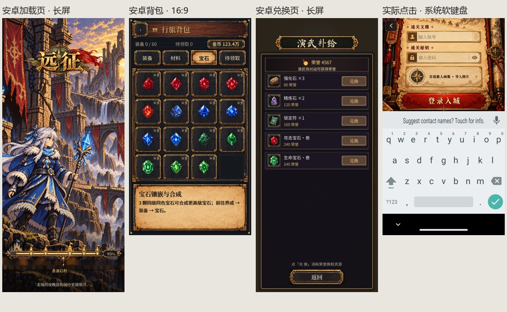

# Android 模拟器实际运行记录

2026年10月24日。已安装官方 Android Emulator，在 Android 17 / API 37 AOSP x86_64 镜像内安装并运行游戏。此记录替代“只在 Windows 调整窗口尺寸”的验证方式；仍不代表用户手机或完整问题清单已经验收通过。

## 运行环境与包的范围

- Pixel 9 虚拟设备，WHPX 硬件虚拟化，AMD 本机 GPU，4 GB 内存、4 核。系统镜像已按官方清单 SHA-1 和 ZIP CRC 校验，见 [image_verification.json](image_verification.json)。
- 普通流程包 `Yuanzheng-emulator.apk` 为同一项目导出的 x86_64 版本，已通过标题、登录、游客创建角色、序章跳过进入地图。它与手机 ARM64 `0.2.1-mobile2` 包的283个脚本及JSON逐字节一致，见 [code_equivalence.json](code_equivalence.json)。原生处理器库不同；这不等于直接在 x86 模拟器运行了用户的 ARM64 APK。
- `Yuanzheng-android-audit.apk` 是随后导出的 Android 巡检包，增加隔离存档和自动打开页面的入口，并包含本轮兑换页修改。正式手机导出预设不启用该特性，且明确排除 `src/qa/`。巡检包不作为手机交付包。
- 所有数据来自本次 `emulator-5554`。没有连接、操作或清理用户手机。
- 最终巡检包与模拟器实际安装的 `base.apk` SHA-256一致，当前源码指纹及库类型记录在 [final_build_verification.json](final_build_verification.json)。

## 实际完成的检查

| 配置 | 系统与显示 | 检查范围 |
| --- | --- | --- |
| [挖孔长屏](long_cutout/device.json) | Android 17 / API 37，1080×2424，三键导航，顶部挖孔安全区136物理像素 | 15页实际 Android 渲染截图、原生软键盘截图和安全区记录 |
| [16:9 屏幕](classic_gesture/device.json) | Android 17 / API 37，720×1280，手势导航，无挖孔 | 同样15页；实际点击账号框验证软键盘和登录内容位置 |

页面包括加载、登录、登录键盘、主城、活动、背包宝石、小聚、设置、养成、图鉴、召唤、兑换、任务、地区行路图和演武场。每组保存 `runtime.json`、系统 `logcat.txt`、各页面PNG和 ADB 整屏截图；截图是 Android 运行画面。

自动边界扫描仅检查可见、可操作、非滚动/裁剪区域的按钮。地区图故意在裁剪窗口中拖动，不能把地图画布外的地点当作固定按钮越界。两组均未发现这类按钮越界；这不证明没有文字过小、视觉位置欠佳、热区冲突或功能问题。截图已人工检查，完整流程、平板、厂商圆角以及系统栏临时唤出仍需继续覆盖。

## 本轮确认与修改

加载界面的背景在两种屏幕比例下均覆盖整个游戏视口，进度和提示完整可见；没有复现原先的底部纯色补条。[长屏加载页](long_cutout/loading.png)、[16:9加载页](classic_gesture/loading.png)。这只关闭了这两个模拟器配置下的该现象，不关闭全部页面适配问题。

兑换页旧图中返回文字为浅金色叠在浅色按钮上，对比很低，缩图几乎不可辨认。本轮换成深色按钮，并将主体改为按安全区高度布局、商品区伸展/滚动、返回固定在底部；不改变兑换价格或扣费。[修改前](android_audit/exchange.png)、[长屏修改后](long_cutout/exchange.png)、[16:9修改后](classic_gesture/exchange.png)。

背包宝石页实际显示了15种宝石纹理。[长屏](long_cutout/bag.png)、[16:9](classic_gesture/bag.png)。材料全量、不同账号持有情况和反复切页仍需专项检查，M01不据此全量关闭。

登录软键盘最初不弹出。系统设置搜索输入框可以弹出，引擎导出包中 `GodotEditText.showKeyboard` 遇到物理键盘会直接返回。虽然 AVD 设置了 `hw.keyboard=no`，AOSP x86内核仍暴露 `AT Translated Set 2 keyboard`。在仅本次虚拟设备上临时解绑已确认的 `atkbd/serio0` 后，系统输入法与游戏输入框均正常弹出：长屏记录高度901物理像素，系统状态 `mInputShown=true`、`mIsInputViewShown=true`。账号、密码和登录按钮移动到键盘上方；16:9也已通过实际点击确认。[长屏系统软键盘](long_cutout/native_keyboard.png)、[16:9实际点击](classic_gesture/login_keyboard_native.png)。本轮没有为此修改游戏键盘实现；物理键盘与软键盘并用的行为另行保留。

首轮巡检误用 `save_locked` 保护测试存档，触发了真实存档恢复弹窗，覆盖主城与活动截图。已修正测试初始化顺序并重跑；`android_audit/` 首轮图片仅保留排查，不作为这两页的有效验收。有效记录以 `long_cutout/`、`classic_gesture/` 为准。

## 尚未解决和未覆盖

| 问题 | 当前结论与下一步 |
| --- | --- |
| 游戏运行中切换系统导航/挖孔配置发生原生崩溃 | [after_overlays_logcat.txt](after_overlays_logcat.txt) 保存 Scudo / InputEventReceiver 释放异常。当前两组按“停止应用→改系统配置→冷启动”检查稳定布局；这只是隔离测试条件，不能写成崩溃已修复。需继续确认导航切换的 Activity 重建与原生库生命周期 |
| 登录长屏空白、召唤/演武等旧页面布局 | 仍有固定画布居中或整张海报的实现。零按钮越界不等于视觉完成，M03继续返工；按顶部、伸展内容和底部动作逐页调整 |
| 状态栏和导航栏临时显示、切后台 | 已覆盖固定三键/手势配置和原生键盘，未完成全页面瞬时系统栏遮挡与反复恢复，M04未全量通过 |
| 骑乘与地图道具 | 本轮15页巡检未覆盖动态骑乘、马蹄声逐帧同步及全部地图旗帜，M06/M08/M09仍待 Android 动态录制 |
| 音效主观异常 | 未做外放、耳机、蓝牙试听。模拟器音频HAL出现 tinyalsa timeout，需区分宿主音频链路与游戏混音；不可据此认定玩家手机音频原因，也不把既有音效机制测试当试听通过 |
| 应用图标、货币说明、通用弹窗全量 | 本轮页面巡检未完整覆盖对应状态，M02/M07/M10维持专项复验 |

原始M01至M10及A01至A07不标记“全部解决”。本轮完成的是可复现的 Android 测试环境、两组实际运行记录，以及兑换页修正；整体手机适配仍在返工。

## 复现

在项目根目录运行 `powershell -File tools/android-emulator/Start-Android17.ps1`，如需操作窗口可手动加 `-ShowWindow`。脚本默认后台启动。环境说明见 [tools/android-emulator/README.md](../../tools/android-emulator/README.md)。

使用本机Python执行 `reports/android_emulator_20261024/run_android_audit.py long_cutout --install --touch-only` 或 `classic_gesture --touch-only`，顺序执行。脚本明确限定 `emulator-5554`；触控模式只在确认 `ro.kernel.qemu=1` 的虚拟设备解绑已确认的 PS/2键盘。重启虚拟设备，或以root向 `/sys/bus/serio/drivers/atkbd/bind` 写回 `serio0` 可恢复，不修改宿主Windows键盘。

模拟器软件 SwiftShader 在本机出现 GLES3 uniform 上限错误，因此使用已运行通过的本机GPU后端。SDK沿用本机代理下载。

参考：[Android模拟器命令行](https://developer.android.com/studio/run/emulator-commandline)、[Godot Android API接入](https://docs.godotengine.org/en/stable/tutorials/platform/android/javaclasswrapper_and_androidruntimeplugin.html)、[Godot社区已有模拟器键盘问题记录](https://github.com/godotengine/godot/issues/87052)。社区案例仅作为排查线索；本次判断另有本机导出包、设备状态和截图证据。
