# 游戏画面修复与截图复验

2026 年 10 月 27 日。已完成此前检查列出的八项修复，经过多轮实际渲染、对照和调整；最终主截图共 42 张，覆盖十八张地图及主要页面，另有三档尺寸专项截图和六敌同屏交互截图。

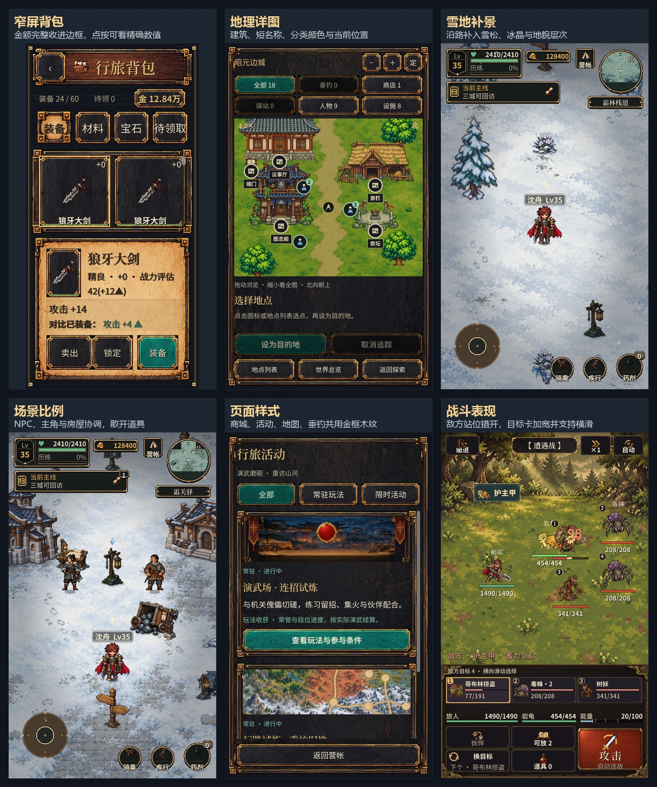

| 原问题 | 最终行为 |
| --- | --- |
| 窄屏金币越界、卖出按钮拥挤 | 320 宽度下显示“金 12.84万”；点按金额区可查看精确金币数，完整数值提示也留在屏内。卖出采用短文案，保持完整触摸区域。 |
| 地图圆点难以辨认 | 底图加入实际建筑、景物与地点短名；标记按类别区分颜色，名称避让图标。默认查看人物附近，缩小能看全图，保留缩放、拖动、分类、列表、追踪与取消。 |
| 野外画面空旷 | 补景优先按路段安排，再填充外围；加入可见岩体、雪松、冰晶，限制重复枯井，并避让主路、出入口和交互点。 |
| 人物、NPC、房屋与道具不协调 | 人类 NPC 身高接近主角，建筑适当放大；将霜关的灯桌与货车分开放置。 |
| 新旧页面风格差异大 | 商城、活动、地理详图和垂钓控件共用背包体系的金框、深木纹与玉色主按钮。 |
| 敌群及目标信息拥挤 | 拉开敌方前后排并错开纵向站位，编号移到形象侧上方、血条靠近脚下；目标卡加宽，支持点按选敌和横向拖动，拖动不误选。窄屏另适配战场与指令区。 |
| 地区图入口被裁切 | “地理详图与玩法地点”固定在底部，三档尺寸都无需滚动即可完整看到并打开。 |
| 长屏主城留白过多 | 拉近城景和主角，将任务条移近角色，底部出征与导航保持可用。 |

## 修复前后对照

每张对照图左侧为修复前，右侧为修复后；均来自游戏实际运行。沙漠与雪地采用相同主角位置，页面采用相同窗口尺寸；地图对照展示各版本打开后的默认视野。

### 窄屏金额与操作

缩写金额完整显示；卖出按钮采用短文案。

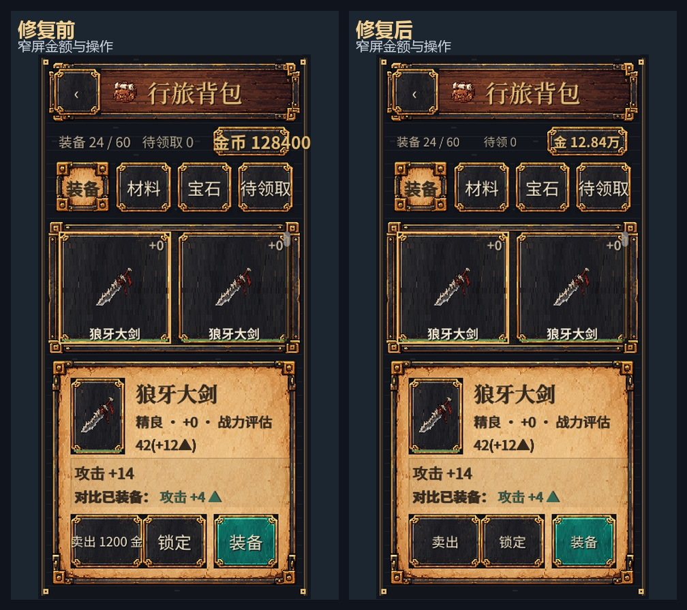

### 地图辨识与默认视野

增加实际建筑、名称、分类色；先看身边，缩小可看全图。

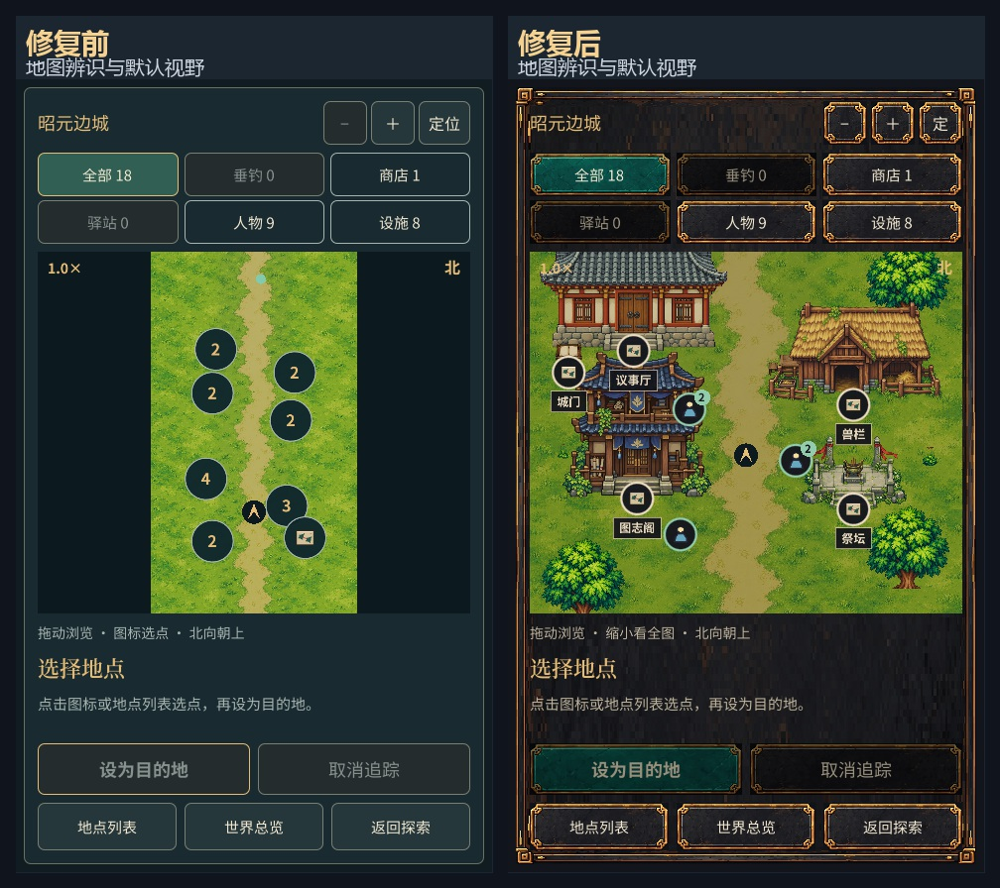

### 沙漠可见地标

按路段放置岩体，限制枯井重复。

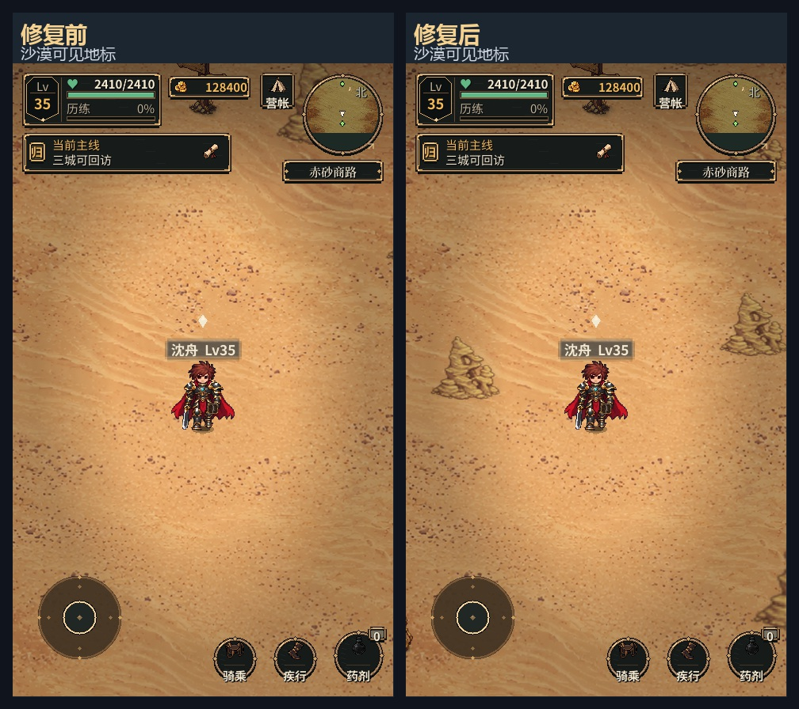

### 雪地景物层次

沿路安排雪松、冰晶，保留道路和交互点。

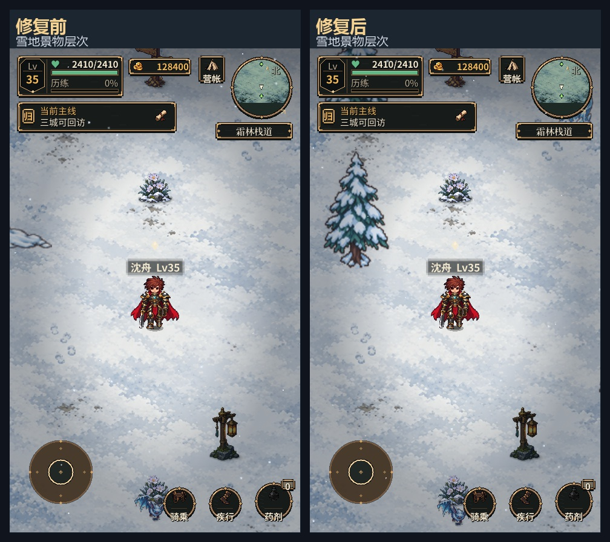

### 人物与场景比例

人类 NPC 接近主角身高，放大建筑，散开货车与灯桌。

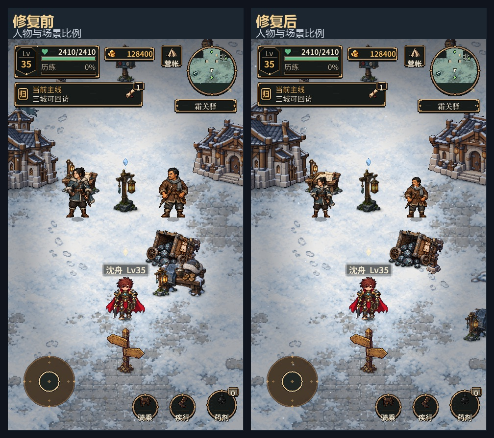

### 共用页面视觉

金框、深木纹、玉色主按钮与背包、任务保持一致。

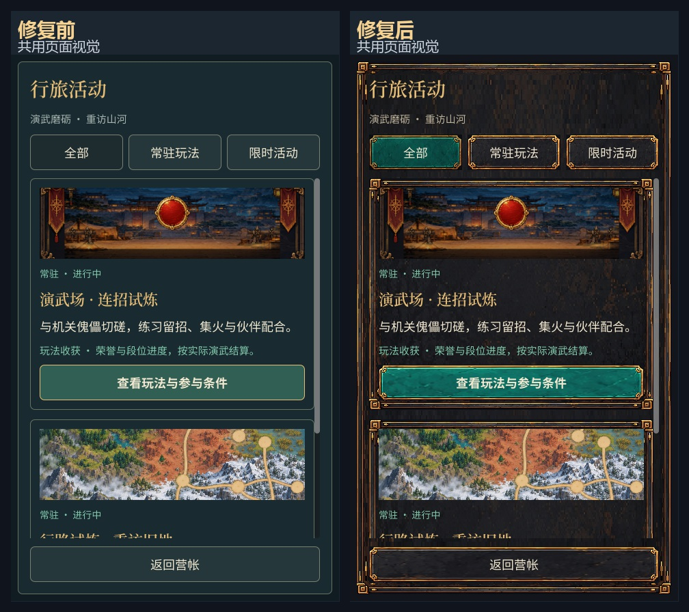

### 战斗目标辨识

拉开前后排、分离编号与血条、加宽可横滑目标卡。

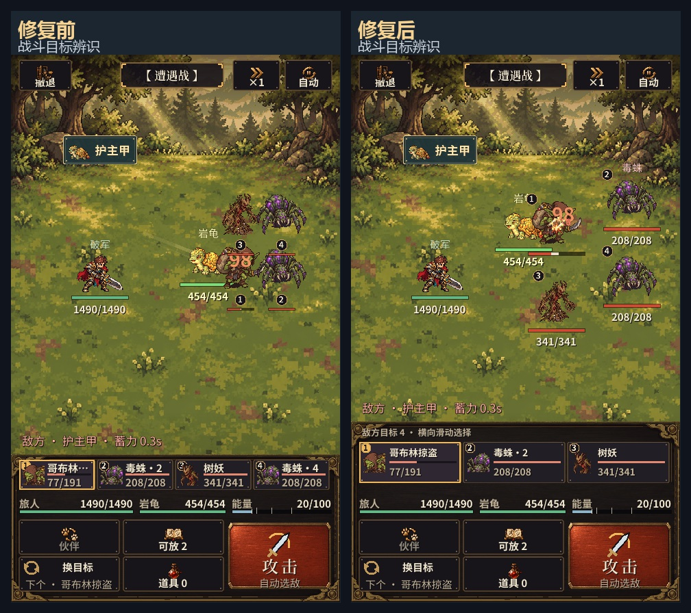

### 地区图固定入口

地理详图按钮无需滚动即可完整看到。

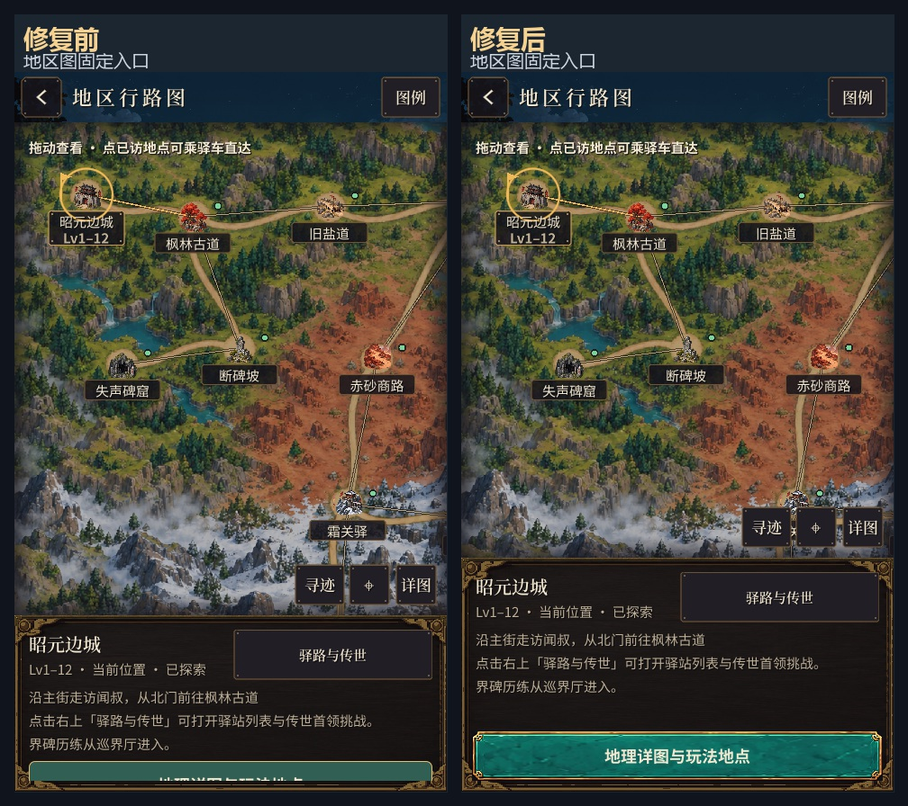

### 长屏主城构图

拉近城景与主角，将任务条移近角色。

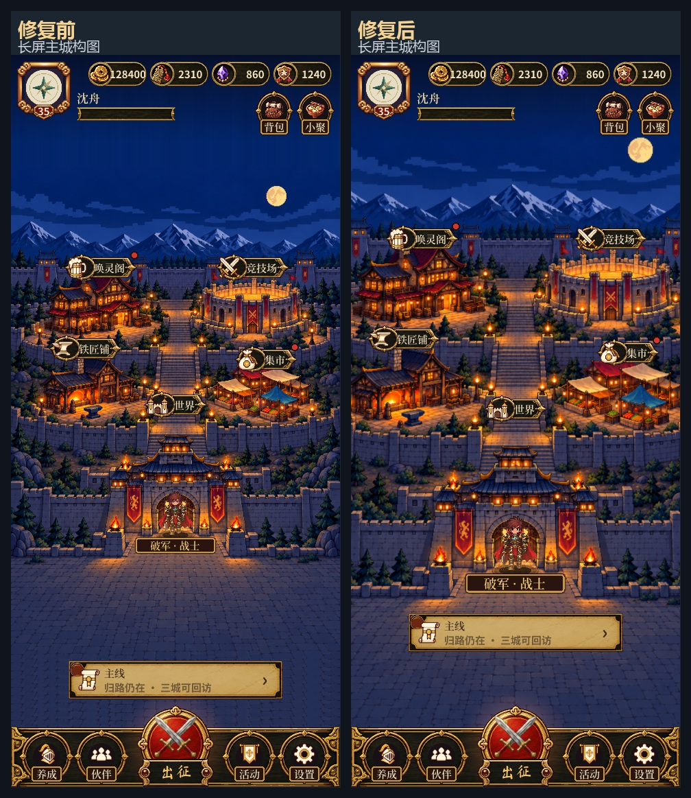

## 覆盖与验证

| 检查 | 结果 |
| --- | --- |
| 本轮专项布局与真实触摸回放 | 199 项通过，0 失败；覆盖 480×800、480×1067、320×640、极端金额、地图全图与局部视野、固定入口、六敌同屏、横滑与点按选敌、鼠标兼容 |
| 背包交互回归 | 528 项通过，0 失败；含物品选择、锁定、卖出、装备、宝石及焦点导航 |
| 地图与世界回归 | 410 项通过，0 失败；覆盖十八张地图和地图筛选、缩放、定位、点选、追踪、取消 |
| 商城、活动、垂钓与导航回归 | 78 项通过，0 失败；包含兑换回滚和实际骑乘导航到钓点后现场交互 |
| 主城入口回归 | 248 项通过；两档高度下实际点击主要入口，验证打开、关闭和首页恢复 |
| 既有战斗与短屏表现回归 | FULL_PLAY_VISUAL_OK，0 失败；六目标卡、血条、召唤结果短屏及天赋入口 |

合计 1,463 项有计数的功能与布局检查通过，另有既有表现回归通过。首次专项测试发现了目标卡触摸点选缺失，修复后重新验收；记录保留在本轮工作目录。

验证使用隔离存档。以上为桌面 Godot 4.7.2 按手机比例实际渲染和输入事件回放；手机触摸手感、安全区和设备性能仍需要真机复验。引擎日志中的本机证书读取错误、既有验收脚本退出资源清理提示，以及保存失败用例的预期锁写警告均保留，功能断言通过不等于这些日志已消失。

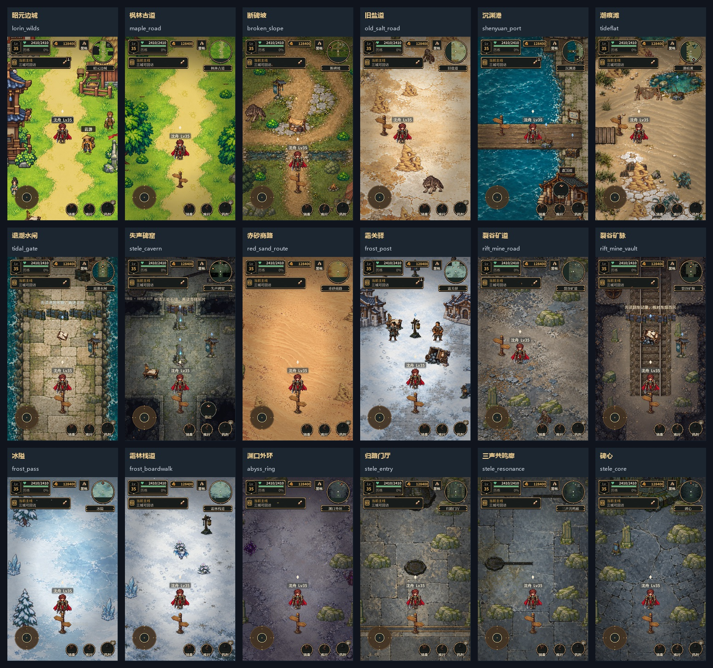

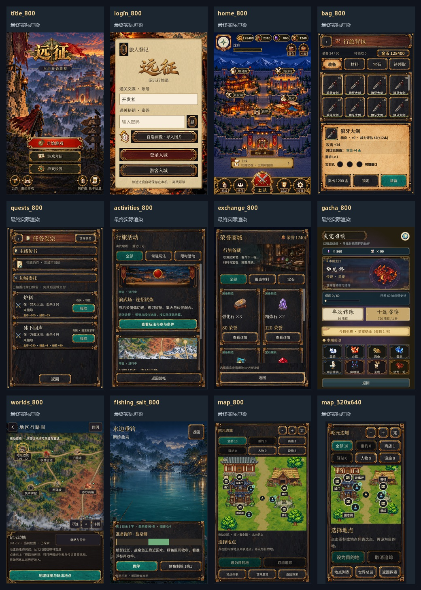

## 文件

- [专项结果](./validation/visual_acceptance.json)
- [验证日志](./validation/visual_acceptance_final.log)
- [本轮源码清单与哈希](./source_manifest.json)
- [相对实施前工作区的增量修改](./changes.patch)
- [最终主截图记录](../../远征/shots/visual_fixes_20261027/release_review/capture_manifest.json)
- [专项截图目录](../../远征/shots/visual_fixes_20261027/acceptance_final)
- [新增专项验收](../../远征/tools/VerifyVisualPolish.gd)

实施前源码位于 `reports/visual_fixes_20261026/before/`。修改基于当前工作区，保留之前已有的玩法与素材工作。
