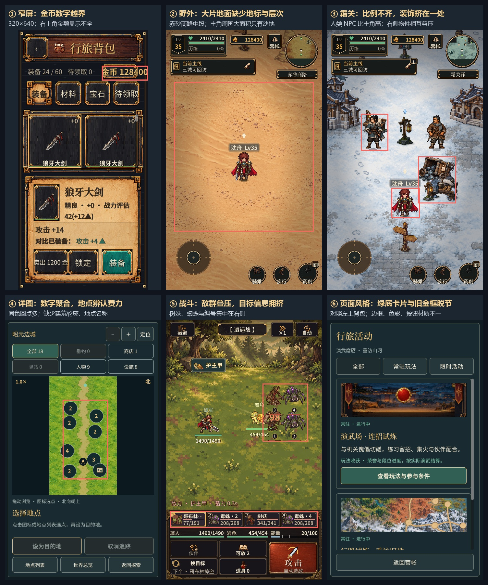

# 当前游戏画面检查

2026-10-26。基于当前工作区 0.2.3-optimization 实际运行截图，覆盖 480×800、480×1067、320×640。使用隔离存档、35 级角色和全功能开放状态，主检查共生成 31 张截图；另补充稳定画面、任务显示与地区图滚动对照。以下是画面检查，不代表 Android 真机触摸与性能验收。

| 优先级 | 问题与实际证据 | 建议处理 |
| --- | --- | --- |
| 高 | **窄屏背包金额越界。** 320×640 时，右上角“金币 128400”超出金框及屏幕右侧；出售按钮文字也接近边框。 | 金额区域随宽度重新分配，长金额缩写或减小字号；窄屏按钮改用更短文案。 |
| 中 | **地理详图缺少辨识信息。** 昭元边城在 480×800 下大部分标记表现为同色数字圆点，地面只见草地与道路；缺少房屋轮廓、可见地点名称。320 宽时，18 个地点主要聚成 4、4、7、3 等数字点。 | 增加建筑轮廓和重要地点短名，按类别区分标记。密集区保留聚合，但优先让玩家直接认出商店、人物与设施。 |
| 中 | **部分地图仍空旷。** 赤砂商路中段几乎只见主角和大面积沙地，霜林栈道中段只有零散树、灯和小物件。补景总数增加没有保证每个可见区域都有层次。 | 按可见镜头规划近、中、远层次，沿路径安排岩群、残迹、地貌变化；保留通行空间。 |
| 中 | **人物、NPC、房屋和道具比例尚未协调。** 霜关画面里人类 NPC 明显高于主角，房屋相对偏小；主角右上方的货车、灯、桌案、石块集中叠压。 | 以统一的人高和门高校准角色与建筑，按场景功能分组摆放物件，减少局部重叠。 |
| 中 | **新旧页面的视觉体系差异明显。** 背包、任务、主城使用高密度金框和木纹；商城、活动、地理详图使用简洁的绿底卡片和细边框；垂钓使用更写实的山水插画。 | 统一边框、按钮材质、底色与标题样式；保留各页面插画，但统一交互控件。 |
| 中 | **战斗目标信息拥挤。** 树妖和蜘蛛集中在右侧相互叠压，编号、伤害字与血条集中；底部目标卡同时占用较少的宽度，长名称省略。 | 调整前后排间距、血条与编号位置，提高选中目标的轮廓和高亮辨识度。 |
| 低 | **地区行路图新入口在首屏露出不全。** 480×800 时底部“地理详图与玩法地点”只露出按钮上部；滚动下方说明区后可完整看到，入口并未失效。 | 将常用入口固定在说明区外，或为底部内容提供更明显的滚动提示。 |
| 低 | **长屏主城留白偏多。** 480×1067 时顶栏下方夜空和角色下方广场占比较大，角色与任务条相距较远。 | 缩减非交互留白，把角色、任务提示与出征操作组织得更紧凑。 |

建议先处理金额越界，再处理地图辨识及场景比例、密度，之后统一页面视觉。初轮快速截取的个别野外画面曾未显示任务正文；等待画面稳定后，正文字符串及实际截图均正常，因此未列为已确认缺陷。

## 原始截图

- [窄屏背包](../../远征/shots/visual_review_current_20261026/bag_320x640.png)
- [赤砂商路中段](../../远征/shots/visual_review_current_20261026/world_red_sand_route_middle.png)
- [任务正文稳定复验记录](../../远征/shots/visual_review_current_20261026/hud_observation.json)
- [霜关驿](../../远征/shots/visual_review_current_20261026/world_frost_post.png)
- [霜林栈道中段](../../远征/shots/visual_review_current_20261026/world_frost_boardwalk_middle.png)
- [地理详图](../../远征/shots/visual_review_current_20261026/map_800.png)
- [窄屏地理详图](../../远征/shots/visual_review_current_20261026/map_320x640.png)
- [战斗](../../远征/shots/visual_review_current_20261026/battle_800.png)
- [活动中心](../../远征/shots/visual_review_current_20261026/activities_800.png)
- [荣誉商城](../../远征/shots/visual_review_current_20261026/exchange_800.png)
- [地区行路图首屏](../../远征/shots/visual_review_current_20261026/worlds_800.png)
- [地区行路图滚动后](../../远征/shots/visual_review_current_20261026/worlds_800_scrolled.png)
- [长屏主城](../../远征/shots/visual_review_current_20261026/home_1067.png)
- [主要截图记录](../../远征/shots/visual_review_current_20261026/capture_manifest.json)
